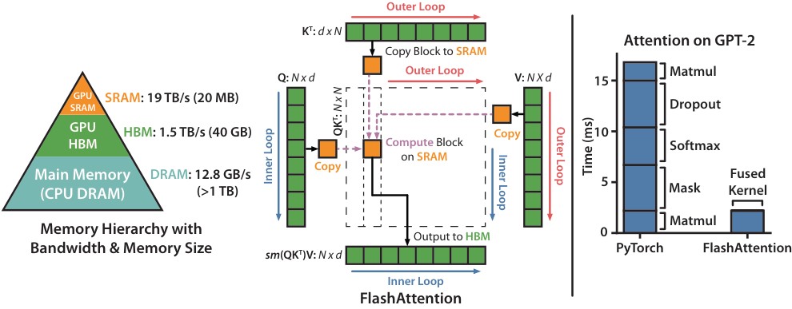
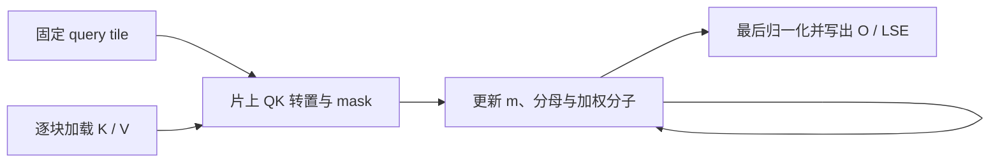

# 01 · FlashAttention 的前向与反向

FlashAttention 保留标准 softmax attention 的数学定义，改变的是中间结果存在哪里、按什么顺序计算。理解它需要把三个量分开：算术复杂度仍随序列长度平方增长，显存不再保存完整 attention 矩阵，HBM 流量则由分块复用决定。下面从一行 softmax 推到 tiled forward，再从链式法则推导 backward，最后对照算子实现。

## 1. 标准 attention 的代价

忽略 batch 与 head，设 $Q,K\in\mathbb R^{N\times d}$、$V\in\mathbb R^{N\times d_v}$，$\tau=1/\sqrt d$。本文始终令 $S$ 表示**已经缩放和加 mask 的 logits**：

$$
S=\tau QK^\top+M,\qquad
P_{ij}=\frac{e^{S_{ij}}}{\sum_k e^{S_{ik}}},\qquad
O=PV.
$$

$M_{ij}$ 对可见位置为 0，对不可见位置为 $-\infty$。假设每行至少有一个可见 key。先算完整 $S$，再做 softmax，再乘 $V$ 的实现，需要在 HBM 写出、读回两个 $N\times N$ 中间矩阵。

| 成本 | 朴素实现 | FlashAttention |
|---|---|---|
| attention 算术量 | $O(N^2(d+d_v))$ | 同阶；反向另有重算 |
| 保存完整 S/P | $O(N^2)$ | 不保存 |
| 输入、输出与每行统计 | $O(N(d+d_v))$ | 同阶 |
| HBM 访问 | 包含大规模 S/P 往返 | 依赖 tile 与片上容量，通常显著减少 |

softmax 与中间矩阵读写具有较低 arithmetic intensity，是朴素实现的重要瓶颈。但不能把「attention 永远 memory-bound」当成定律：长序列 fused attention、不同 head dimension 和硬件可能进入 compute-bound 区域。FA 正是通过减少数据搬运，把更多时间留给矩阵乘法。



图源：[FlashAttention 论文 Fig. 1](https://arxiv.org/abs/2205.14135)。左侧是小而快的片上存储与大而慢的 HBM，右侧是论文的特定实验结果。阅读时重点看 S/P tile 只在片上出现；图中加速比不代表所有 shape 与硬件。

### 显存复杂度不等于 IO 复杂度

令 $d_v=d$，$M_{\mathrm{SRAM}}$ 表示片上可容纳的标量元素数，省略字节宽度。在论文讨论的容量范围内，FA 的 HBM 访问量为

$$
\Theta\!\left(\frac{N^2d^2}{M_{\mathrm{SRAM}}}\right),
$$

并至少需要读写 $\Omega(Nd)$ 的输入输出。它不是普遍的 $O(Nd)$：一个 KV tile 仍可能被不同 query tile 重复加载。线性的是无需保存 $N\times N$ 中间矩阵的**空间占用**，不是在固定 SRAM 下所有输入只读一遍。论文中的 IO 上界与这一单位约定见 [FA §3.2](https://arxiv.org/abs/2205.14135)；进一步的下界分析见 [Saha & Ye](https://arxiv.org/abs/2402.07443)。

## 2. 一行 softmax 的可合并状态

固定 query $i$，把已访问的 key 集合记作 $A$。定义三个统计量：

$$
\begin{aligned}
m_A&=\max_{j\in A} S_{ij},\\
\ell_A&=\sum_{j\in A}e^{S_{ij}-m_A},\\
u_A&=\sum_{j\in A}e^{S_{ij}-m_A}v_j.
\end{aligned}
$$

$m_A,\ell_A$ 是标量，$u_A$ 是 $d_v$ 维向量。该集合上的归一化输出为 $o_A=u_A/\ell_A$。保存 $u_A$ 而非已归一化的 $o_A$，可以避免每处理一个 tile 都做除法。

现在得到另一个不相交集合 $B$ 的统计量。两者能合并为

$$
\begin{aligned}
m&=\max(m_A,m_B),\\
\ell&=e^{m_A-m}\ell_A+e^{m_B-m}\ell_B,\\
u&=e^{m_A-m}u_A+e^{m_B-m}u_B.
\end{aligned}
$$

这不是近似：只是把两部分分子、分母改用同一个指数基准。关键恒等式的方向是

$$
e^{S_{ij}-m}=e^{S_{ij}-m_A}\,e^{m_A-m}.
$$

新基准更大时，旧贡献要缩小。若写成相反方向，就会把旧块放大，失去 softmax 的正确归一。

### 一个两块例子

取 logits 为 $(0,\log 2,\log 4)$，value 为标量 $(1,3,5)$，把前两项与最后一项分别作为两个 tile。第一块有 $m_A=\log2$、$\ell_A=1.5$、$u_A=3.5$；第二块有 $m_B=\log4$、$\ell_B=1$、$u_B=5$。合并时第一块乘 $1/2$：

$$
\ell=\frac12\cdot1.5+1=1.75,\qquad
u=\frac12\cdot3.5+5=6.75,\qquad
o=\frac{27}{7}.
$$

直接计算也得到 $(1+2\cdot3+4\cdot5)/(1+2+4)=27/7$。独立地对两块做 softmax 再平均两个输出则不对，因为丢失了两块分母的相对大小。

上述 merge 在实数算术下可结合，因此可以按顺序流式处理，也可以树形合并或跨 GPU 合并。浮点加法不满足精确结合律，不同 tile/规约顺序一般只保证数值接近，不保证逐位一致。

## 3. Tiled forward

取一个 query tile $Q_i\in\mathbb R^{B_r\times d}$，依次访问 KV tile $K_j,V_j$。对 tile 中每一行分别维护 $m,\ell,u$，初值为 $(-\infty,0,0)$。新 tile 到来时：

$$
\begin{aligned}
S_{ij}&=\tau Q_iK_j^\top+M_{ij},\\
m'&=\max(m,\operatorname{rowmax}(S_{ij})),\\
\alpha&=e^{m-m'},\qquad \widetilde P_{ij}=e^{S_{ij}-m'},\\
\ell'&=\alpha\odot\ell+\operatorname{rowsum}(\widetilde P_{ij}),\\
u'&=\alpha\odot u+\widetilde P_{ij}V_j.
\end{aligned}
$$

行向量统计量在列维广播，$u$ 的 shape 为 `[Br, dv]`。全部可见 tile 处理完后才计算

$$
O_i=u/\ell,\qquad L_i=m+\log\ell.
$$

$L_i$ 就是每行 log-sum-exp，简称 LSE。保存它可以让 backward 直接重建每一个概率，不必再扫描整行计算分母。



原始 FA1 的 IO 分析与 Algorithm 1 采用 KV 外层遍历；上述固定 query tile 的写法更接近常见 FA2 forward 调度。二者共享同一 online softmax 恒等式，不应把某一种 loop nesting 当成所有版本的不变量。

### Mask 与数值边界

causal attention 中，完全位于未来的 tile 可直接跳过；跨对角线的 tile 逐元素 mask。全被 mask 的局部 tile 不贡献任何值，应跳过或显式处理，避免计算 $-\infty-(-\infty)$。如果某一行全局没有可见 key，softmax 本身没有通常意义的概率定义，输出行为应由 API 明确规定。

指数减去最大值可避免上溢，但不能消除全部舍入误差。累积分母和输出通常使用 FP32；QK、PV 的矩阵乘法可使用低精度输入。这里的 exact 指没有改变 attention 定义，与「所有中间操作都无限精度」不同。

## 4. 从链式法则推导 backward

记损失为 $\mathcal L$，上游梯度为 $G=\nabla_O\mathcal L$。以下先假设没有 dropout。由 $O=PV$：

$$
\nabla_V\mathcal L=P^\top G,\qquad
\nabla_P\mathcal L=GV^\top.
$$

对一行 softmax，Jacobian 为

$$
\frac{\partial P_{ij}}{\partial S_{ik}}
=P_{ij}(\delta_{jk}-P_{ik}).
$$

代入链式法则得到

$$
(\nabla_S\mathcal L)_{ij}
=P_{ij}\left((\nabla_P\mathcal L)_{ij}-D_i\right),
\qquad
D_i=\sum_kP_{ik}(\nabla_P\mathcal L)_{ik}.
$$

如果直接按右边求 $D_i$，似乎还要遍历整行概率。但利用 $O_i=\sum_kP_{ik}V_k$，可得

$$
D_i=\sum_kP_{ik}\langle G_i,V_k\rangle
=\left\langle G_i,\sum_kP_{ik}V_k\right\rangle
=\langle G_i,O_i\rangle.
$$

因此只需要对每行输出维度做一次点积，就能预先求出全部 $D$。这是 backward 能逐 tile 独立恢复概率并求导的关键。

最后，由 $S=\tau QK^\top+M$，有

$$
\nabla_Q\mathcal L=\tau(\nabla_S\mathcal L)K,\qquad
\nabla_K\mathcal L=\tau(\nabla_S\mathcal L)^\top Q.
$$

固定 mask 不需要求导。缩放 $\tau$ 在 Q/K 梯度中各出现一次；恢复概率时直接使用已经缩放的 $S$，不能再重复乘 $\tau$。

## 5. 不保存 P 的 tiled backward

forward 保存 Q/K/V、O、LSE；其中 Q/K/V 本来就是输入，不需要另复制一套。backward 先算 $D_i=\langle G_i,O_i\rangle$，然后对每个可见的 tile 重算

$$
\begin{aligned}
S_{ij}&=\tau Q_iK_j^\top+M_{ij},\\
P_{ij}&=e^{S_{ij}-L_i},\\
E_{ij}&=G_iV_j^\top,\\
F_{ij}&=P_{ij}\odot(E_{ij}-D_i).
\end{aligned}
$$

接着累加三个梯度：

$$
\begin{aligned}
\nabla_{V_j}\mathcal L&\mathrel{+}=P_{ij}^\top G_i,\\
\nabla_{Q_i}\mathcal L&\mathrel{+}=\tau F_{ij}K_j,\\
\nabla_{K_j}\mathcal L&\mathrel{+}=\tau F_{ij}^\top Q_i.
\end{aligned}
$$

所有 $B_r\times B_c$ 的概率和 score 梯度都可以在片上生成、使用、丢弃。LSE 已包含全局分母，当前 tile 不需要知道其他 tile 的 logits。

| 梯度 | 需要归约哪个方向 | 调度含义 |
|---|---|---|
| dQ 的一个 tile | 所有可见 KV tile | 固定 Q 时可本地累积 |
| dK/dV 的一个 tile | 所有引用它的 Q tile | 固定 KV 时可本地累积 |

常见 backward 固定 KV tile，以减少 dK/dV 写入冲突；dQ 则需要原子加或额外归约。也可以使用不同分工或分开的 dQ kernel。并不存在一种固定循环方向同时消除全部跨 tile 累加。

### Dropout 与确定性

若 attention probability 使用 dropout，令 $R_{ij}$ 为保留 mask 除以保留概率，则 $O=(P\odot R)V$。此时

$$
\nabla_V\mathcal L=(P\odot R)^\top G,\qquad
\nabla_P\mathcal L=(GV^\top)\odot R.
$$

仍有 $D_i=\langle G_i,O_i\rangle$，但 backward 必须恢复 forward 的同一份 $R$。因此实现保存 RNG seed/offset 等状态，按同一逻辑位置重放随机数，无需保存一个平方大小的 dropout mask。是否使用确定性归约、具体 RNG 映射由实现保证。

### 重算为什么可能更快

FA 多算了一遍 QK，却少了保存和读取完整 P，以及其他平方中间量的 HBM 往返。重算成本与 IO 节省的大小由硬件和 shape 决定，不能断言它总能被完全隐藏。该策略也不同于整层 activation checkpointing：FA 仅重算 attention 内部的 S/P，不必重算 QKV projection 和 FFN。

## 6. 对照实现

理解上述定义后，只需把实现中的 `acc_o` 对应到未归一分子 $u$，把 `softmax_lse` 对应到 $L$，把 `delta` 或 `D` 对应到 $\operatorname{rowsum}(G\odot O)$。不同版本可能使用自然对数或 base-2 LSE，恢复概率时必须配套转换。

### LSE 形式的状态更新

这份 Triton 参考实现不单独存 $m$ 和 $l$，而是直接维护 **$\mathrm{lse} = m + \log(l)$**（log-sum-exp）。看 [[flash-attention:flash_attn/flash_attn_triton.py#L212-L252]]：

```python
# m_ij = 本块 rowmax 与历史 lse 取 max（lse 充当 running max 的上界）
m_ij = tl.maximum(tl.max(qk, 1) * softmax_scale, lse_i)   # :215
p    = tl.exp(qk * softmax_scale - m_ij[:, None])         # :216
l_ij = tl.sum(p, 1)                                       # :217
acc_o_scale = tl.exp(m_i - m_ij)                          # α，修正旧累加  :220
acc_o = acc_o * acc_o_scale[:, None]                      # :226
acc_o += tl.dot(p, v)                                     # 加新块贡献    :247
m_i = m_ij                                                # :250
l_i_new = tl.exp(lse_i - m_ij) + l_ij                     # :251
lse_i = m_ij + tl.log(l_i_new)                            # 更新 lse     :252
# 循环结束后一次性归一：
o_scale = tl.exp(m_i - lse_i)                             # = 1/l        :254
acc_o = acc_o * o_scale[:, None]                          # :258
```

`lse` 既是 backward 需要的统计量（见第 5 节），又省去了单独存 $l$ 的开销。注意整个循环里 `acc_o` 都没有除以 $l$，只在最后乘一次 `o_scale` $= \exp(m - \mathrm{lse}) = 1/l$。这个「延迟归一」是 FA2 削减 non-matmul FLOPs 的雏形。

### 用 `exp2` 替代 `exp`

GPU 的 SFU（special function unit）提供硬件 `exp2`（base-2 指数）指令，比 `expf` 快。FA 把 $\exp(x)$ 改写成 $\mathrm{exp2}(x \cdot \log_2 e)$，并把 $\log_2 e$ 预乘进 softmax_scale，这样循环里只剩一条 `exp2`。看 [[flash-attention:csrc/flash_attn/src/softmax.h#L66-L88]] 的 `scale_apply_exp2`：

```cpp
// max_scaled = max(mi) * scale  (scale 已含 log2e)
tensor(mi, ni) = exp2f(tensor(mi, ni) * scale - max_scaled);   // :86/:88
```

因此 C++ 代码里到处出现 `scale_softmax_log2`、`softmax_scale_log2`（而不是 `softmax_scale`），FA4 CuTeDSL 同理使用 `scale_log2` 加 `cute.math.exp2(...)`（[[flash-attention:flash_attn/cute/softmax.py#L168-L181]]）。读 kernel 时看到 `_log2` 后缀和 `exp2` 不必困惑，它们对应的就是这个微优化。`Softmax::softmax_rescale_o` 的 `Is_first` 模板参数是另一个优化：处理第一个 KV 块时不需要 $\alpha$ 修正（此时还没有旧累加），可以在编译期特化掉。


更多代码对应：

- [[flash-attention:csrc/flash_attn/src/flash_fwd_kernel.h#L302-L410]]：QK、online softmax 和 PV 的 fused mainloop。
- [[flash-attention:flash_attn/flash_attn_triton.py#L510]]：用 LSE 重算概率。
- [[flash-attention:flash_attn/flash_attn_interface.py#L873]]：autograd 保存的输入、输出、LSE 与 RNG state。

## 7. 三个可复用的结论

| 机制 | 数学依据 | 延伸 |
|---|---|---|
| Online softmax | 分子分母可以换基并合并 | Ring Attention、split-K decode |
| 重算概率 | $P_{ij}=\exp(S_{ij}-L_i)$ | 不保存平方中间量的 backward |
| 输出点积 | $D_i=\langle G_i,O_i\rangle$ | 省掉对整行 P/dP 的额外归约 |

这三条等式比某个 kernel 的循环结构更稳定。下一篇 [FA2](./02_fa2_parallelism.md) 讨论如何减少非 matmul 开销、增加 query 维并行并调整 warp 分工；[[atlas:docs/attention/fa/fa_lab.ipynb|FA lab]] 可用于逐项验证 forward 与 backward。
