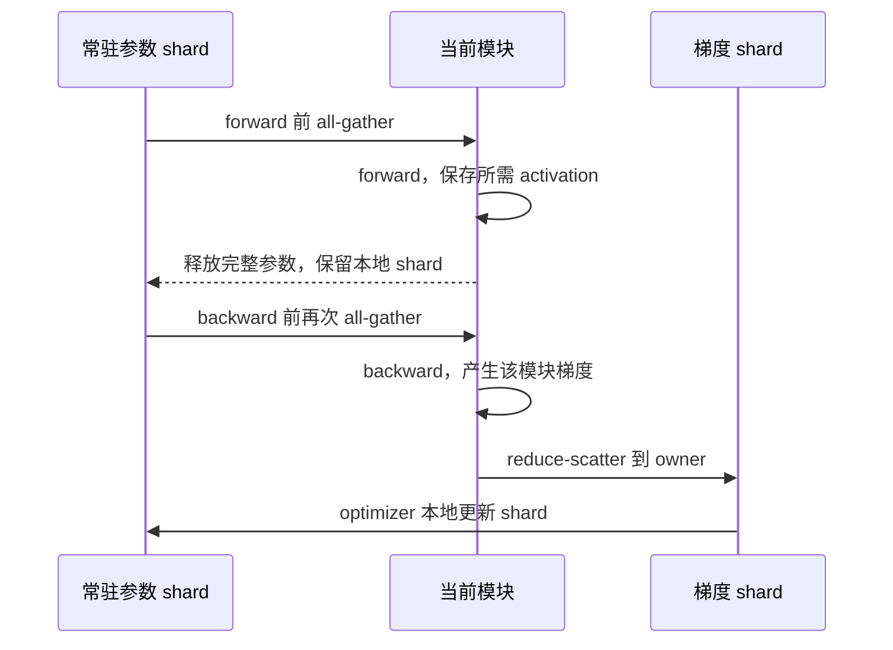

# 02 · ZeRO 的三级分片

DDP 的每个 rank 处理不同的数据，却保存相同的模型状态。增加 GPU 可以增加训练吞吐，但不会自动减少单卡上的参数、梯度和 Adam 状态。ZeRO 的出发点是：这些状态只需要在整个 DP group 内完整，未必需要在每个 rank 上完整。本篇先说明分片为什么保持更新语义，再依次推导 ZeRO-1、ZeRO-2 和 ZeRO-3，最后对应到 Megatron 的实现。

## 1. 状态与精度

设一个 DP group 有 $N$ 个 rank，每个模型副本包含 $P$ 个参数。若已经采用 TP/PP，$P$ 指当前 TP/PP 位置负责的参数量。AdamW 对第 $i$ 个参数的更新为

$$
\begin{aligned}
m_{t,i}&=\beta_1m_{t-1,i}+(1-\beta_1)g_{t,i},\\
v_{t,i}&=\beta_2v_{t-1,i}+(1-\beta_2)g_{t,i}^2,\\
\theta_{t+1,i}&=(1-\eta_t\lambda)\theta_{t,i}
-\eta_t\frac{\widehat m_{t,i}}{\sqrt{\widehat v_{t,i}}+\epsilon}.
\end{aligned}
$$

一旦拿到全局平均梯度 $g_{t,i}$，这一坐标的更新不需要其他坐标的 Adam 状态。因此可以给参数坐标指定唯一的 **owner**，由它保存状态并执行更新。若使用 global gradient clipping，还要先规约整个模型的 norm；对于包含矩阵级操作的 optimizer，也需要重新检查其分片约束，不能直接套用 Adam 的逐坐标论证。

为了与 ZeRO 原论文对齐，先使用经典的 mixed-precision Adam 账本：

| 状态 | 每参数字节 | 用途 |
|---|---|---|
| 低精度参数 | 2 | forward/backward 的计算权重 |
| 低精度梯度 | 2 | 当前 optimizer step 的梯度 |
| FP32 master 参数 | 4 | 在更高精度下累积小更新 |
| FP32 一阶、二阶状态 | 8 | Adam 的历史统计 |
| 合计 | 16 | 不含 activation 与临时 buffer |

这是一套明确的假设，不是所有框架固定的内存布局。FP32 梯度会把基线从每参数 16 字节改成 18 字节；某些 BF16 训练方案没有独立 master，FP32 参数本身也可能承担 master 的角色。以下把每参数的参数、梯度、optimizer 字节数分别记为 $b_p,b_g,b_o$；经典例子取 $(2,2,12)$。

图源：[ZeRO 论文 Fig. 1](https://arxiv.org/abs/1910.02054)。图中的 optimizer state 包含 mixed-precision master；先沿水平方向看哪些颜色被分片，再读每卡总量。图里没有计入 activation，不能把最右侧数字直接当成训练峰值。

## 2. ZeRO-1：分片 optimizer

把参数坐标划成互不重叠的集合 $I_0,\ldots,I_{N-1}$。rank $r$ 对自己的 batch 产生梯度 $g^{(r)}$，owner $s$ 所需的是

$$
\overline g_{I_s}=\frac{1}{N}\sum_{r=0}^{N-1}g^{(r)}_{I_s}.
$$

各 rank 不必都拿到完整的 $\overline g$。reduce-scatter 可以同时完成求和与按 owner 分发；是否除以 $N$ 由框架的 scaling 约定决定。

以两个 rank、四组参数为例：

| 时刻 | rank 0 | rank 1 |
|---|---|---|
| forward 前 | 完整参数 A、B、C、D；只保存 A、B 的 optimizer state | 完整参数 A、B、C、D；只保存 C、D 的 optimizer state |
| 本地 backward | 本地 batch 对 A、B、C、D 的梯度 | 另一个 batch 对 A、B、C、D 的梯度 |
| reduce-scatter 后 | A、B 的全局平均梯度 | C、D 的全局平均梯度 |
| optimizer step | 更新 A、B | 更新 C、D |
| all-gather 后 | 完整的新 A、B、C、D | 相同的完整新参数 |

all-gather 收集的是**更新后的参数**，不是梯度。由于 optimizer 状态和更新只保留一份，全体 rank 在下一次 forward 前仍能拿到相同参数。

图源：[PyTorch FSDP2 教程](https://docs.pytorch.org/tutorials/intermediate/FSDP_tutorial.html)。图展示同一张量上 all-reduce 的分解。ZeRO-1 在两步之间插入本地 optimizer update，因此前半段传梯度，后半段传参数。

ZeRO-1 只保证 optimizer state 被分片：

$$
M_1=P(b_p+b_g)+\frac{Pb_o}{N}.
$$

在经典账本下即 $4P+12P/N$。梯度虽然最终只使用 owner 的片段，完整 grad buffer 仍可能常驻。**一次 reduce-scatter 的输出只有一段，不等于输入 buffer 的其余部分已经释放。**

## 3. ZeRO-2：缩短梯度的存活期

ZeRO-2 在 ZeRO-1 的基础上，让梯度也只由 owner 长期持有。理解它要把「产生梯度」和「保留梯度」分开：每张卡仍对本地数据计算整个模型的梯度，但某个 bucket 一旦就绪，就把它规约到 owner，并回收本地不属于自己的部分。

因此 ZeRO-1 与 ZeRO-2 可以使用相同的 collective，却有不同的内存生命周期：

| 行为 | ZeRO-1 的典型实现 | ZeRO-2 的典型实现 |
|---|---|---|
| 本地梯度产生 | 全模型 | 全模型 |
| 梯度规约 | reduce-scatter 或等价操作 | 分 bucket reduce-scatter 或等价操作 |
| 非 owner 梯度的 storage | 可能留在完整连续 buffer 中 | 尽早释放或复用 |
| 跨 micro-batch 累积 | 可保留完整梯度 | 尽量在 owner 的 shard 上累积 |

静态模型状态下界变成

$$
M_2=Pb_p+\frac{P(b_g+b_o)}{N}.
$$

经典账本下为 $2P+14P/N$。但刚生成的梯度和在途通信仍要占空间，实际峰值还包含一个或多个 bucket。实现若为 overlap 保留整块未分片输入，就不能用上式声称已经达到 ZeRO-2 的显存。

### Gradient accumulation 的取舍

假设每次 optimizer update 累积 $A$ 个 micro-batch。DDP 可以前 $A-1$ 次暂不通信，最后一次统一 all-reduce。ZeRO-2 若要始终维持梯度 shard，通常需要在各 micro-batch 规约后累积 shard；这样节省显存，但 RS 的次数可能增加。反过来，延迟同步能减少通信次数，却可能需要保留完整梯度。

两种方式在正确 scaling 下都能得到相同的平均梯度：

$$
\overline g=\frac{1}{NA}\sum_{r=0}^{N-1}\sum_{a=1}^{A}g^{(r,a)}.
$$

这里假设各 micro-batch 有相同权重。变长序列按有效 token 数归一时，应按 token 总数加权，不能对各 rank 的均值再简单平均。

## 4. ZeRO-3：按需物化参数

ZeRO-2 的极限仍包含一整份参数 $Pb_p$。ZeRO-3 把参数也分片，但它没有把每个 matmul 改成 TP：**计算某个模块时，每个 rank 仍使用该模块的完整权重，处理自己的数据。** 完整参数只在需要它的时间段存在。

forward 后释放参数，并不意味着不再需要它：线性层 $Y=XW$ 的输入梯度是 $\nabla_X\mathcal L=(\nabla_Y\mathcal L)W^\top$，所以 backward 需要重新拿到 $W$。forward 保存的 activation 与参数 shard 是两类不同的对象；参数分片不会自动消除 activation。

静态模型状态为

$$
M_3=\frac{P(b_p+b_g+b_o)}{N}.
$$

若最大的 gather unit 有 $U$ 个参数，只考虑一个完整 unit 与其梯度，一个粗略峰值模型是

$$
M_{\mathrm{peak}}\approx M_3+M_{\mathrm{activation}}
+c_p b_pU+c_g b_gU+M_{\mathrm{workspace}}.
$$

$c_p,c_g$ 表示同时存活的完整参数、梯度 buffer 数量；是否复用 shard storage、是否 prefetch 都会影响它们。这是保守估算框架，不能当成精确 allocator 公式。把整个模型设成一个 gather unit，会使 $U=P$，从而削弱 ZeRO-3 的峰值收益。

## 5. 显存比较

| 模式 | 参数 | 梯度 | Optimizer | 经典总量 |
|---|---|---|---|---|
| DDP | 完整 | 完整 | 完整 | $16P$ |
| ZeRO-1 | 完整 | 完整 | shard | $4P+12P/N$ |
| ZeRO-2 | 完整 | shard | shard | $2P+14P/N$ |
| ZeRO-3 | shard | shard | shard | $16P/N$ |

以 7B 参数、8 个 rank 为例，使用十进制 GB：

| 模式 | 参数 | 梯度 | Optimizer | 模型状态合计 |
|---|---|---|---|---|
| DDP | 14 GB | 14 GB | 84 GB | 112 GB |
| ZeRO-1 | 14 GB | 14 GB | 10.5 GB | 38.5 GB |
| ZeRO-2 | 14 GB | 1.75 GB | 10.5 GB | 26.25 GB |
| ZeRO-3 | 1.75 GB | 1.75 GB | 10.5 GB | 14 GB |

从 ZeRO-1 到 ZeRO-2 节省的是 12.25 GB 的长期梯度 storage；从 ZeRO-2 到 ZeRO-3 再节省 12.25 GB 的长期参数 storage。每一步都还有 activation、gather buffer 和通信空间要加。若梯度实际为 FP32，DDP 基线应为 126 GB，其他行也要按 $b_g=4$ 重算。

## 6. 通信量与执行时间

下面统一按**每个 rank 发送的字节数**计量，不把收发相加，也不把全网络流量混进来。用 ring 风格的带宽模型，记 $c_N=(N-1)/N$。对大小为 $B$ 字节的完整张量，all-reduce 发送 $2c_NB$，reduce-scatter 与 all-gather 各发送 $c_NB$。

在每步一次 backward、参数在 forward 后立即 reshard、不做额外 recompute gather 的简化条件下：

| 模式 | 每步主要 collective | 每 rank 发送字节 |
|---|---|---|
| DDP | gradient all-reduce | $2c_NPb_g$ |
| ZeRO-1/2 | gradient RS + updated parameter AG | $c_NP(b_g+b_p)$ |
| ZeRO-3 | parameter AG 两次 + gradient RS | $c_NP(b_g+2b_p)$ |

只有在 $b_p=b_g$ 时，ZeRO-1/2 的流量与 DDP 相同，ZeRO-3 才是它们的 1.5 倍。若参数 BF16、梯度 FP32，则三行分别为 $8c_NP$、$6c_NP$、$8c_NP$ 字节。原论文常写的 $2P/3P$ 是同精度下的**元素传输量**，不能与每参数 16 字节的显存公式混读。

流量相同也不意味着训练时间相同。一个实用的通信模型是

$$
T_{\mathrm{comm}}\approx n_{\mathrm{collective}}\alpha+\frac{V_{\mathrm{bytes}}}{B_{\mathrm{eff}}},
$$

其中 $\alpha$ 是每次 collective 的有效启动成本。切得更细可以更早开始通信，但会增加启动次数；prefetch 可以隐藏通信，也会多占显存。最终要看关键路径上有多少通信没有被 compute 覆盖，而非只比较总字节数。

## 7. 常见优化

| 方法 | 省掉或隐藏什么 | 代价与边界 |
|---|---|---|
| Bucketing 与 overlap | 把梯度规约、参数 gather 与其他层计算重叠 | bucket 太小启动成本高，太大则启动太晚 |
| 参数 persistence | 小参数或近期再用的参数不反复释放 | 增加常驻显存，减少小 collective |
| Hybrid sharding | 在高速子组内分片，子组间复制 | 状态只除以子组大小，跨组仍需同步梯度 |
| CPU offload | 把 optimizer、梯度或参数放到 host | PCIe 带宽、CPU optimizer 和 pinned memory 成为约束 |
| NVMe offload | 用 SSD 扩大可容纳模型状态 | 需要分层 prefetch；容量充足不代表吞吐高 |
| Activation checkpointing | 省 activation，与 ZeRO 互补 | 重算增加 FLOPs，调度不当还可能增加参数 gather |

[ZeRO-Offload](https://arxiv.org/abs/2101.06840) 讨论 CPU/GPU 的分工，[ZeRO-Infinity](https://arxiv.org/abs/2104.07857) 进一步把 NVMe 纳入内存层次。这些是状态放置与调度策略，不是 ZeRO-1/2/3 之后新的分片级别。DeepSpeed 的可调项及行为见[官方 ZeRO 文档](https://deepspeed.readthedocs.io/en/latest/zero3.html)。

## 8. Megatron DistributedOptimizer

`DistributedOptimizer`（见 [[megatron-lm:megatron/core/optimizer/distrib_optimizer.py#L102]]）的关键工作，是把「连续 grad buffer 里的 $1/N$ 段」映射回「具体是哪些参数的哪些部分」：

- **shard 映射**（见 [[megatron-lm:megatron/core/optimizer/distrib_optimizer.py#L129]] 起）：每个 DP rank $r$ 拥有连续 buffer 里的第 $r$ 段（也就是 `dp_rank'th shard of each bucket`，见 [[megatron-lm:megatron/core/optimizer/distrib_optimizer.py#L241]]）。这一段可能会横跨多个参数，也可能切在某个大参数的中间，所以这里按连续 buffer 的元素区间划分，不要求遵守参数边界。FSDP1 的 FlatParameter 也可能跨参数边界切分；FSDP2 才改为 per-parameter sharding。
- **三组参数**（`_build_model_and_main_param_groups`，见 [[megatron-lm:megatron/core/optimizer/distrib_optimizer.py#L324]]），分别是：
  - `shard_float16_groups`：原始 bf16 参数的分片视图，用于 all-gather 回写；
  - `shard_fp32_from_float16_groups`：bf16 参数对应的 fp32 master 分片，这是 optimizer 真正要更新的对象；
  - `shard_fp32_groups`：本来就是 fp32 精度的参数分片。
- **step**：optimizer 只在这些 `shard_*` 上跑 Adam 更新，所以 $m$、$v$、master 都只需要存 $1/N$。

Megatron 的传统 distributed optimizer 属于 optimizer-state sharding。当前笔记所引用的连续 `grad_data` 仍是完整 buffer，owner 只读取其中一段，因此不能把它直接按 ZeRO-2 的梯度显存记账。FP32 梯度下，典型常驻开销是 $6P+12P/N$，与[训练显存模型](../../train/07_memory_model.md)一致。

参数 all-gather 也可以按 bucket 调度；`overlap_param_gather` 在下一次 forward 需要对应参数前完成同步，并不要求一次 gather 全模型。ZeRO-1 与 ZeRO-3 的区别是完整参数是否长期保留，而不是是否存在分块 all-gather。

`num_distributed_optimizer_instances` 则把 DP group 分成若干实例：实例内分片 optimizer，实例间同步对应梯度 shard。它与 HSDP 具有相同的分层思想。TP/PP 参数 shard、dense 参数的 DP group、MoE expert 的 expert-DP group 必须分别记账，不能统一除以 world size。

## 参考与下一步

- [ZeRO](https://arxiv.org/abs/1910.02054)：状态分片、显存账本与通信分析。
- [DeepSpeed ZeRO 教程](https://www.deepspeed.ai/tutorials/zero/)：三个阶段及 offload 的配置实例。
- [[megatron-lm:megatron/core/optimizer/distrib_optimizer.py]]：optimizer shard 映射与更新。
- [[megatron-lm:megatron/core/distributed/param_and_grad_buffer.py]]：通信 buffer 的实际存活范围。

下一篇：[FSDP1 与 FSDP2](./03_fsdp.md)，把 ZeRO-3 展开成模块生命周期、分组粒度、prefetch 与 checkpoint。
