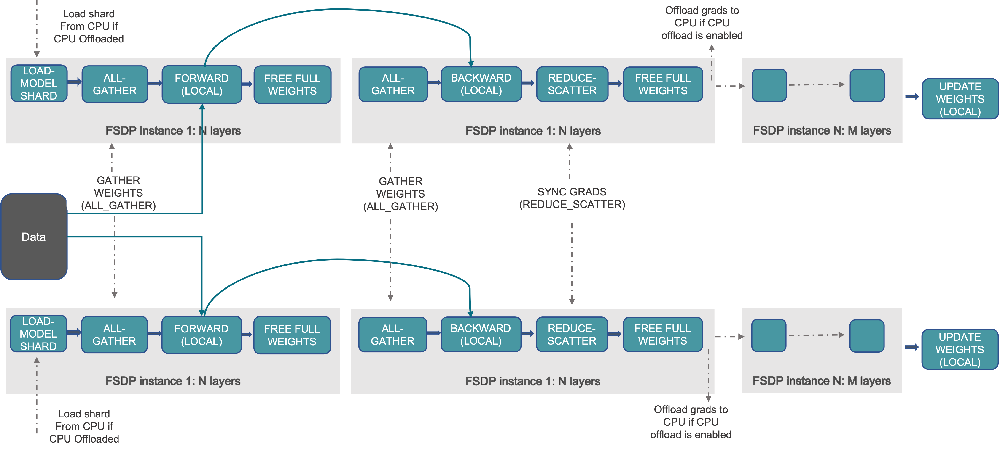
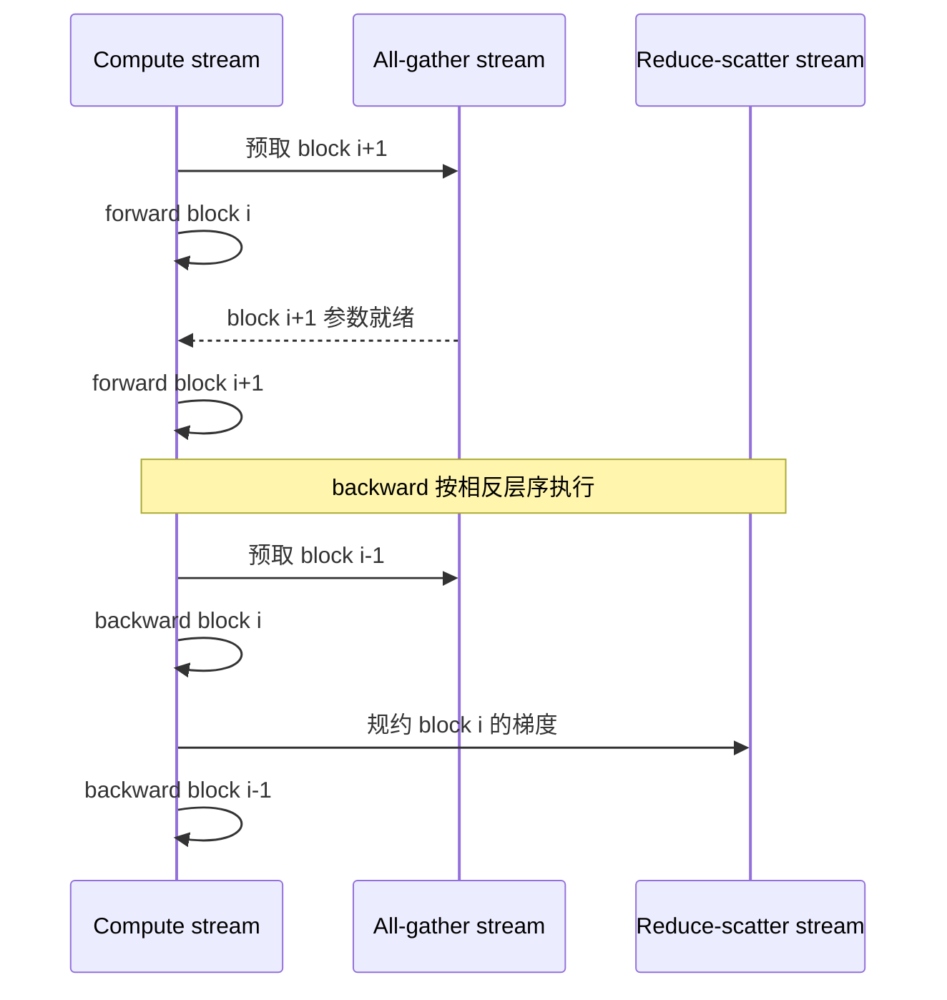
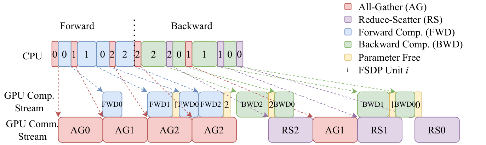

# 03 · FSDP1 与 FSDP2

ZeRO-3 给出了参数、梯度和 optimizer state 全部分片的原则，FSDP 则把这一原则组织成可组合的模块执行机制。理解它最重要的三个问题是：一份完整参数何时存在，哪些参数一起通信，以及通信能否赶在计算需要它之前完成。FSDP1 与 FSDP2 在这些基本语义上相同，主要区别在参数表示和运行时管理。核验时的 PyTorch 官方教程已将 FSDP1 标为 deprecated；这里保留它是为了理解现有工程与迁移差异，新设计优先评估 FSDP2。

## 1. FSDP 仍然是数据并行

FSDP 的 rank 处理不同的样本。一个模块执行 matmul 时，每个 rank 都有该模块所需的完整权重，输出与输入的布局仍由本地 batch 决定。TP 则把同一个 matmul 的权重与计算切到多张卡上。两者可以组合，但分片发生的时刻和目的不同。

**FSDP 的参数 shard 是长期存储形式，完整参数是临时计算形式。** 这里的「完整」是相对于 FSDP 维度而言；如果还叠加 TP，gather 后得到的仍可以是当前 TP rank 对应的权重切片。



图源：[PyTorch FSDP2 官方教程](https://docs.pytorch.org/tutorials/intermediate/FSDP_tutorial.html)。沿执行方向看，参数在计算前聚合，梯度在计算后规约；optimizer 处理的是各 rank 的 shard。图展示 full-shard 模式，不涵盖保留完整参数等变体。

## 2. 一个 unit 的生命周期

FSDP unit 是一起调度参数 gather 与梯度规约的一组参数，常以 Transformer block 为单位。假设启用 forward 后 reshard：

| 阶段 | 参数形态 | 动作 | 必须保留什么 |
|---|---|---|---|
| 空闲 | 本地 shard | 等待模块被调用 | 参数 shard、optimizer shard |
| pre-forward | 完整参数 | all-gather，必要时转计算精度 | 当前 unit 的完整权重 |
| forward | 完整参数 | 处理本地 batch | backward 所需 activation |
| post-forward | 恢复 shard | 释放完整权重 storage | shard 和 activation |
| pre-backward | 再次完整 | all-gather | backward 所需权重 |
| backward | 完整梯度逐步就绪 | 计算输入、参数梯度 | 正在规约的梯度 buffer |
| post-backward | 参数与梯度 shard | reduce-scatter，释放完整 buffer | owner 的全局梯度 shard |
| optimizer step | shard | 各 rank 更新本地片段 | 下一步的参数 shard |

reshard 通常不是再发一次 scatter。各 rank 原本就知道自己的 shard；在权重未改变的 forward/backward 阶段，释放临时完整 buffer、恢复 shard 表示即可。真正交换数据的是 all-gather 与 reduce-scatter。

还需区分 optimizer step 的时机：梯度逐 unit 规约不代表可以任意提前更新该 unit。gradient accumulation、global norm clipping、共享参数及未完成的 backward 都可能要求等到全步结束。

## 3. Unit 粒度与峰值

全模型一次 gather 最简单，却可能在 forward 前重新物化整个模型，失去按层释放的收益。反过来，给每个小 Linear 都建一个 unit，会产生大量小 collective。Transformer block 常是合适的起点，因为其计算量通常足以与相邻 block 的参数 gather 重叠。

设总参数量为 $P$，最大 unit 为 $U$，shard group 大小为 $N$。在[ZeRO 的账本](./02_zero_and_distributed_optimizer.md)基础上，可把峰值理解为

$$
M_{\mathrm{peak}}\approx
\frac{P(b_p+b_g+b_o)}{N}
+M_{\mathrm{activation}}
+M_{\mathrm{live\ units}}
+M_{\mathrm{communication}}.
$$

$M_{\mathrm{live\ units}}$ 取决于当前 unit、预取 unit，以及 forward 后未释放的 unit。它不一定只等于 $b_pU$。padding、dtype cast、copy-in/copy-out、allocator 也会扩大实际占用。因而 FSDP 调优要看时间轴上的峰值，而不是只把参数量除以 GPU 数。

还有两个结构性细节：embedding/lm_head 往往比单个 block 大，需要单独检查；tied weight 必须由能覆盖所有使用位置的同一生命周期管理，不能把共享 storage 当成两份独立参数随意分片。

## 4. Forward 后是否 reshard

FSDP2 用 `reshard_after_forward` 表达这项选择。下面只计每个 unit 一次 forward、一次 backward：

| 选项 | forward 后 | backward 前 | 主要通信 |
|---|---|---|---|
| `True` | 释放完整参数 | 再次全组 gather | 两次 AG + 一次 RS |
| `False` | 保留完整参数 | 直接使用 | 一次 AG + 一次 RS |
| 合法整数子组大小 | 只保留部分 reshard 后的参数 | 在更小组内 gather | 用中间显存换较少的 backward 通信 |

整数选项的合法范围与设备组约束以[官方 API](https://docs.pytorch.org/docs/stable/distributed.fsdp.fully_shard.html)为准。它不会改变本地数据的 DP 语义。

默认值也需要分清：FSDP2 的 `None` 让运行时推断，通常非 root unit 在 forward 后 reshard，root unit 保留参数，以避免 forward 结束后紧接着 backward 又做同一份 gather。因此不能把「所有 unit 默认都是 True」当成通则。实践中应先在 child blocks 上应用 `fully_shard`，再处理 root 的剩余参数，避免 root 无意间拥有整个模型。

FSDP1 的 `FULL_SHARD` 大体对应 `True`，`SHARD_GRAD_OP` 大体对应 `False`。后者在计算期间保留完整参数，但空闲时仍可能使用参数 shard，不宜把它的全部生命周期直接等同于传统 ZeRO-2。

## 5. Prefetch 与 overlap

参数 all-gather 在 forward 和 backward 的关键路径上：如果下一层权重尚未到齐，计算必须停下来。prefetch 的作用是把这次等待提前到上一层还在计算的时间段。



若 block $i$ 的计算耗时为 $T_i$，下一个 gather 耗时为 $A_{i+1}$，理想情况下暴露的等待约为

$$
T_{\mathrm{stall},i+1}\approx\max(0,A_{i+1}-T_i).
$$

这个模型只说明依赖关系。AG、RS、TP 通信可能争用同一网络链路；copy 操作、通信算子也可能争用 HBM 或 SM，所以不能把不同 stream 当成免费并行资源。



图源：[PyTorch FSDP 论文 Fig. 5](https://arxiv.org/abs/2304.11277)。观察重点是 gather 如何进入相邻层的计算区间，以及首尾仍有哪些无法隐藏的通信。

更深 prefetch 增加同时在途的完整参数数量。FSDP1 提供 `limit_all_gathers`，限制 CPU 过早发出 gather，避免显存超前膨胀；FSDP2 改进了内存与 stream 管理，**不提供同一个配置项**。FSDP2 的默认 backward prefetch 与可配置的 forward/backward prefetch 应按其自身 API 调整，不能照搬 FSDP1 参数。相关差异见[官方迁移指南](https://docs.pytorch.org/tutorials/intermediate/FSDP_tutorial.html#fsdp1-to-fsdp2-migration-guide)。

## 6. FSDP1 的 FlatParameter

FSDP1 通常先把一个 unit 的参数展平成一个大 FlatParameter，再把它切成等长 shard。例如三个参数分别有 6、4、6 个元素，拼成 16 个元素后在两个 rank 上各存 8 个。rank 0 会持有第一个参数和第二个参数的一部分；rank 1 持有剩余部分。

这种布局方便合并通信，但逻辑参数边界与 storage shard 边界不一致。optimizer param group、冻结参数、不同 dtype、checkpoint 名字映射，都需要知道原参数与 flat buffer 的关系。`use_orig_params=True` 可以保留原参数接口，但底层仍有 flatten/view 的管理，不能理解成已经采用了 FSDP2 的表示。

分片策略包括 `FULL_SHARD`、`SHARD_GRAD_OP`、`HYBRID_SHARD` 等；它们决定参数何时释放、分片 group 与复制 group 怎样组织。FSDP1 不等于某一个固定策略，使用它也不自动意味着每次 forward 都 reshard。

## 7. FSDP2 的 per-parameter sharding

FSDP2 默认按各参数的 dim 0 独立分片，用 DTensor 表达全局形状、mesh 和 placement。一个二维权重在 checkpoint 里仍对应同一个逻辑参数，不必先还原 FlatParameter 再拆回多个 tensor。

**per-parameter 表示不意味着逐参数发一个 collective。** 同一个 `fully_shard` group 内仍可打包多个参数，统一 all-gather 与 reduce-scatter。参数表示的粒度和通信的粒度是两个选择。

| 维度 | FSDP1 | FSDP2 |
|---|---|---|
| 入口 | `FullyShardedDataParallel(module)` wrapper | `fully_shard(module)` 原位组合 |
| 长期参数表示 | FlatParameter 与原参数 view | 各参数的 DTensor shard |
| 通信分组 | wrap policy / nested wrappers | 对哪些模块调用 `fully_shard` |
| Sharding 配置 | `sharding_strategy` | mesh + `reshard_after_forward` |
| 参数名与状态导出 | 需要 flat/original 映射 | 保留 per-parameter 表示 |
| 混合精度 | `MixedPrecision` | `MixedPrecisionPolicy` |
| 初始化 | wrapper 中的初始化回调等 | 可先 meta 建模、分片，再 materialize |
| 内存限流 | `limit_all_gathers` | 运行时管理方式不同，无同名开关 |

FSDP2 的基本组装顺序可用这段短例子说明，实际模型初始化与 checkpoint 加载需按项目实现：

```python
from torch.distributed.fsdp import fully_shard

for block in model.blocks:
    fully_shard(block, mesh=dp_mesh, reshard_after_forward=True)
fully_shard(model, mesh=dp_mesh)  # 管理 child groups 之外的剩余参数
optimizer = torch.optim.AdamW(model.parameters(), lr=learning_rate)
```

optimizer 应在分片之后创建。不能绕过模块调用路径直接执行 `model.forward(...)`，因为参数生命周期由模块 hooks 管理。冻结/可训练参数混合、TP+FSDP 等组合仍要检查框架版本与模型行为；更清晰的表示降低了适配成本，并不保证任意组合无需验证。

## 8. HSDP 与网络拓扑

设有 $R$ 个复制组，每组 $S$ 张卡做 full sharding，总 DP 度为 $N=RS$。参数 AG 与梯度 RS 在 shard group 内执行，得到的梯度 shard 再沿 replica 维同步：

$$
\overline g_{I_s}=\frac{1}{RS}
\sum_{r=0}^{R-1}\sum_{s'=0}^{S-1}g^{(r,s')}_{I_s}.
$$

这让频繁的参数 gather 可以留在 NVLink 域，而跨机同步仅处理梯度 shard。状态显存按 $1/S$ 缩减，不是 $1/(RS)$；不同 replica group 各有一整套分布式模型状态。网络拓扑很不均匀时，这种复制可能换来更高吞吐。

这与 TP 的二维 mesh 又不同：HSDP 的两个维度都对应不同样本；DP×TP 中，TP 维合作计算同一批样本。mesh 的维数相同，不代表语义相同。

## 9. Accumulation、精度与 checkpoint

### 梯度同步

FSDP1 的 `no_sync()` 可以延迟梯度规约，但常需要保存完整梯度。FSDP2 通过 `set_requires_gradient_sync` 等接口控制同步；HSDP 还可区分 shard 内规约与 replica 间同步。是否继续 reshard、是否保留未规约梯度会影响显存，不能把 DDP 的低成本 accumulation 经验直接套过来。

在 sharded 梯度上计算 norm 时，应把各 shard 的平方和合并，再开平方：

$$
\|g\|_2=\sqrt{\sum_s\sum_{i\in I_s}g_i^2}.
$$

这里只能计入每个逻辑梯度一次；HSDP replica 与 TP 中复制的参数不能被重复计数。否则 clipping 会随着并行度改变。

### 精度与 activation

参数通信精度、计算精度、梯度规约精度、optimizer 精度不必一致。BF16 参数 AG 配 FP32 梯度 RS，是[ZeRO 通信公式](./02_zero_and_distributed_optimizer.md)不能简单写成「3P」的直接例子。

activation checkpointing 和 FSDP 省的是不同部分。checkpoint 的重算会再次调用模块；wrapper 边界、参数是否仍可用、prefetch 顺序决定是否增加 gather。应联合设计 checkpoint region 与 FSDP unit，并查看真实 timeline。

### 初始化与保存

训练状态放得下，不代表初始化时在每张卡先建完整 FP32 模型也放得下。meta initialization、分片后 materialize 和分布式加载可以避免这个峰值。

同理，sharded checkpoint 能让各 rank 保存本地片段；导出完整权重则必须显式汇集，并留出 CPU/GPU 空间。FSDP2 的 DTensor state dict 可通过 Distributed Checkpoint 做跨拓扑加载；只在 rank 0 保存原始 `state_dict()` 不能替代正确的分布式导出。进一步见[Checkpoint](../../train/03_checkpoint.md)。

## 10. 实现对照与选型

PyTorch FSDP2 的核心对应关系很直接：`unshard` 发起参数 AG，`wait_for_unshard` 建立计算依赖，`reshard` 释放完整表示，`post_backward` 发起梯度 RS。源码对照保留在这里，读完生命周期后再查即可：

- [[pytorch:torch/distributed/fsdp/_fully_shard/_fsdp_param_group.py]]：unit 的状态迁移和 prefetch。
- [[pytorch:torch/distributed/fsdp/_fully_shard/_fsdp_collectives.py]]：参数打包、gather 与梯度规约。
- [[megatron-lm:megatron/core/distributed/fsdp/]]：Megatron 自身的 FSDP 实现。
- [[megatron-lm:megatron/core/distributed/distributed_data_parallel_config.py]]：Megatron 的分片策略配置。

这些源码链接固定于仓库登记的版本，官方 `stable` 文档则随版本更新。Megatron-FSDP 与 PyTorch FSDP2 是不同实现，不能仅凭同名配置假设 buffer 和 hook 完全相同。

| 主要瓶颈 | 优先评估 |
|---|---|
| 参数和完整梯度放得下，optimizer 放不下 | ZeRO-1 |
| 完整梯度太大，参数放得下 | ZeRO-2 或对应 gradient-sharding 策略 |
| 参数本身也放不下 | FSDP full shard、TP/PP，或它们的组合 |
| 跨机 gather 成本高 | HSDP、调整 shard group、扩大 unit 或结合 TP/PP |
| 长序列 activation 占主导 | CP、activation checkpointing，再联合调 FSDP |

不应仅根据模型总参数量决定方案。先用 dtype、unit 粒度与 activation 算出显存，再看网络 topology 和通信关键路径。动手验证可用 [[atlas:docs/parallel/01_dp/dp_lab.ipynb|DP lab]]。

## 参考

- [PyTorch FSDP 论文](https://arxiv.org/abs/2304.11277)：FlatParameter、调度和 rate limiter。
- [FSDP1 API](https://docs.pytorch.org/docs/stable/fsdp.html)：策略与限制。
- [FSDP2 API](https://docs.pytorch.org/docs/stable/distributed.fsdp.fully_shard.html)、[官方教程与迁移指南](https://docs.pytorch.org/tutorials/intermediate/FSDP_tutorial.html)：当前接口语义。
