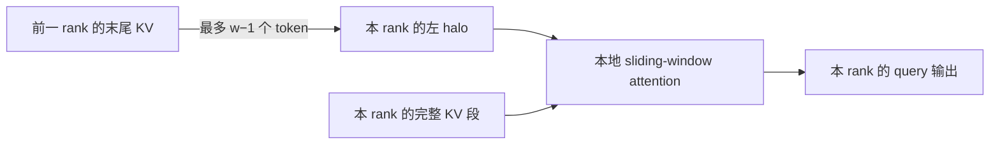
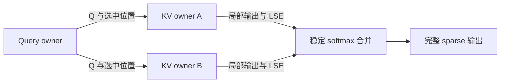

# 05 · Sparse attention CP

Sparse attention 把每个 query 需要的 KV 从完整前缀缩小到一个子集，但这些 KV 仍可能分布在所有 rank 上。因此，稀疏化首先减少的是计算边数；只有数据搬运也利用稀疏结构时，网络流量才会随之下降。本篇沿着「选哪些 KV、在哪里算、怎样合并、梯度如何返回」展开，再讨论负载均衡和实现策略。

前置内容见 [sparse attention 的数学基础](../../attention/mechanisms/03_sparse_static.md)、[NSA 与 MoBA](../../attention/mechanisms/04_sparse_trainable.md) 和 [CP 的任务图](./README.md)。以下讨论的是 **给定 sparse pattern 后的精确分布式计算**；它不保证与原始 dense attention 相同。

## 1. 稀疏度与通信量是两件事

设序列长度为 $N$，query $i$ 的可见 key 集合为 $\mathcal S_i$。Sparse softmax 为

$$
o_i=\frac{\sum_{j\in\mathcal S_i}\exp(s_{ij})v_j}
{\sum_{j\in\mathcal S_i}\exp(s_{ij})},\qquad
s_{ij}=\frac{q_i^\top k_j}{\sqrt d}.
$$

计算量主要取决于有效边数 $\sum_i|\mathcal S_i|$。但 query owner 实际需要获取的不同 KV 数量取决于集合的并：

$$
\mathcal U_r=\bigcup_{i\in\mathcal Q_r}\mathcal S_i,
\qquad
B_r^{\mathrm{remote}}\approx
|\mathcal U_r\setminus\mathcal K_r|\,(d_k+d_v)b.
$$

$\mathcal Q_r$ 是 rank $r$ 持有的 query，$\mathcal K_r$ 是它原本持有的 key 位置，$b$ 是每元素字节数。该式假设同一个 KV 在本轮只传一次，暂不计 head、索引与协议开销。

例如每个 query 只看 1% 的 key，但不同 query 的选择几乎互不重叠，一个 rank 汇总起来仍可能需要接近全部 KV。反过来，大量 query 共享同一小组 key 时，先按 owner 去重，再批量搬运，可以摊薄传输成本。GQA 下还要对共享同一 KV head 的多个 query head 做联合分析。

所以，直接用 sparse 算子替换 ring 中的 dense 算子，可能只减少算力，不减少 ring 搬运量；计算变短后，原来藏在计算后面的通信还会暴露出来。

## 2. 静态模式先利用局部性

### Sliding window 与 halo

约定窗口宽度 $w$ 包含当前位置，query $i$ 访问 $[\max(0,i-w+1),i]$。若各 rank 持有连续序列段、每段长度至少为 $w$，只需从前一 rank 获取最多 $w-1$ 个 KV 作为 halo；本段内部的 KV 均可本地访问。

窗口比 local segment 更长时，halo 会跨多个 rank；packed 文档边界则必须截断 halo。backward 中，halo 对应的 $dK,dV$ 要返回原 owner，并与 owner 自己计算的梯度相加。

### Global token 与压缩分支

少量 sink/global key 可以复制或广播，local window 仍走 halo。若 global token 本身也作为 query 读取全序列，它们的输出需要独立的跨 rank 归约；不能只处理「大家读取 global key」这一方向。

NSA 一类多分支机制还需要区分原始 KV、压缩 KV 和选择出的 KV。压缩窗口跨 rank 边界时，先补齐压缩输入 halo，或明确压缩块的 owner；只有压缩结果满足 causal 可见性后，才可参与后续选择。压缩分支很小，不代表原始 KV 分支可以省略。

## 3. 动态选择怎样跨 rank 完成

动态 top-k 的第一步是确定候选位置，第二步才是读取用于主 attention 的 KV。这两步可能使用不同维度的 key，也可能采用不同通信方式。

一个便于理解的基线是：汇总全部 KV 或 indexer key，在 query owner 上做 selection 和 sparse attention。它实现简单、容易核对正确性，但通信仍随全序列增长。可以先用它建立数值基准，再优化数据路径。

### 分布式 top-k 的候选合并

假设 key 分成 $p$ 个不相交集合，所有 rank 对同一 query 的分数可直接比较。在每个集合中取 local top-k，再对最多 $pk$ 个候选取 global top-k，就能恢复完整集合的 top-k：一个不属于某集合 local top-k 的元素，在自己的集合里已经至少有 $k$ 个更优元素，因此不可能进入 global top-k。

$$
\operatorname{TopK}\!\left(\bigcup_{r=0}^{p-1}\mathcal K_r\right)
=\operatorname{TopK}\!\left(
\bigcup_{r=0}^{p-1}\operatorname{TopK}(\mathcal K_r)\right).
$$

等分数时需统一 tie-breaking；mask 与 token 全局位置也必须一致。各 rank 不能先按自己的局部分母归一化，再把局部概率直接比较，那会改变排序。

候选通信可以只发送位置与分数，再按最终位置取真实 KV。但每个 key owner 首先必须拿到对应 query 或 indexer query；全局 score 计算、候选合并和随机访问都不是免费的。若每 rank 只取少于 $k$ 个候选，或者先做近似路由，则需要另外分析漏选误差。

## 4. 两条主要数据路径

### Query 固定，拉取所需 KV

query owner 把选中的位置按 KV owner 分组、排序、去重，发出请求；KV owner 批量 gather 并返回数据，本地算子随后完成 attention。

这种方式使输出归约留在本地，适合远程 KV 的并集较小、多个 query 可以复用同一 KV 的情况。难点是请求长度不规则、两阶段通信延迟、临时 buffer 峰值，以及热点 KV 的多方读取。

### KV 固定，派发 query

另一种方式把 query 与选择信息发给相关 KV owner。各 owner 在本地计算选中 key 的 partial attention，再把局部输出与 LSE 发回 query owner 合并。

设 owner $r$ 负责的选中 key 子集为 $\mathcal S_{ir}$，这些子集不相交。定义

$$
L_{ir}=\log\sum_{j\in\mathcal S_{ir}}e^{s_{ij}},\qquad
o_{ir}=\sum_{j\in\mathcal S_{ir}}e^{s_{ij}-L_{ir}}v_j.
$$

则完整输出为

$$
L_i=\log\sum_r e^{L_{ir}},\qquad
o_i=\sum_r e^{L_{ir}-L_i}o_{ir}.
$$

这就是 FlashAttention/Ring 使用的稳定归约。**局部输出不能直接相加或取平均**，因为每个局部 softmax 的分母不同。空集合用零贡献处理，避免直接计算负无穷相减；不同分支若重复选到同一个 key，也要先明确去重或混合规则，不能无意中重复计入分母。

该方案避免把热点 KV 复制给每个 query owner，但增加了 Q 与 partial output 的通信；当 value dimension 很大或一个 query 横跨很多 owner 时，返回数据也可能昂贵。应比较实际字节数与消息数，不能仅凭 sparsity ratio 选择。

## 5. Backward 的 owner 关系

给定选中的集合，softmax 梯度与 dense 形式相同，只在有效边上求和。令输出梯度为 $g_i$，则

$$
\frac{\partial\mathcal L}{\partial s_{ij}}
=p_{ij}\,g_i^\top(v_j-o_i),\qquad j\in\mathcal S_i.
$$

这里的 $p_{ij}$ 必须由全局 sparse 分母得到，$o_i$ 也是合并后的输出。KV owner 不能只用自己的局部 softmax 做 backward。

拉取 KV 的方案需要把远程 $dK,dV$ 送回 owner；派发 Q 的方案通常把 $dK,dV$ 留在 KV owner，把部分 $dQ$ 归约回 query owner。多个 query、多个 rank 对同一 key 的贡献必须相加，不能覆盖。可保存选择索引，也可确定性重算，但前后向必须使用相同 pattern。

离散 top-k 的选择操作与主 attention 的梯度是两件事。被选中分数可以求导，集合成员身份通常不能直接通过普通 autograd 求导；DSA 的 indexer 等机制还有自己的训练目标。CP 只负责忠实执行该模型定义，不会自动为离散选择补出梯度。

## 6. 负载均衡要数有效边

Dense causal attention 的 zigzag 划分主要平衡三角形面积。Sparse 模式下，等 token 数、等 head 数都不保证等工作量。一个粗略的 rank 成本模型是

$$
T_r\approx T_{\mathrm{select},r}
+\frac{F_r}{\Pi_r}
+\frac{B_r}{\mathcal B_r}
+n_r\,t_{\mathrm{launch}},
$$

其中 $F_r$ 为有效算力工作量，$\Pi_r$ 为实际吞吐，$B_r$ 为通信字节数，$\mathcal B_r$ 为有效带宽，$n_r$ 为消息或算子启动次数。这只是未计 overlap 的解释模型；真实关键路径还受依赖与资源争用影响。

应同时观察两种失衡：一是某些 rank 的总工作量更多；二是各 rank 总量接近，但某一 ring step 的工作集中在少数 rank，使其他 rank 提前等待。优化总量不一定消除逐步 barrier 的尾部。

实际调度可按 query block 的有效边数分桶，重排高负载 block，把热点 KV 分散或适度复制，并按节点层级组织通信。block 太细会增加 metadata 与 launch 成本；太粗则会计算许多原本不存在的边。Query grouping 可以提高 KV 复用，但若通过扩大选中集合实现分组，还需统计额外计算和 pattern 变化。

## 7. 代表性系统

[MTraining](https://arxiv.org/abs/2510.18830)面向 LLM 长上下文训练，围绕动态稀疏模式提出 balanced sparse ring 和分层通信，特别区分 worker-level 与 step-level imbalance。它说明 sparse CP 需要同时设计 pattern、block 排列与网络调度，不能只把 dense ring 内的算子替换掉。

[DSV](https://arxiv.org/abs/2502.07590)面向 video DiT 训练，分析不同 head、不同 block 的稀疏度差异，并组合 head-wise 与 sequence-wise CP。Head-wise 划分的通信较规则，但 head 的稀疏度不同会造成算力失衡；sequence-wise 划分则要处理随选中 KV 分布变化的数据搬运。DSV 与 DeepSeek 的 DSA 是不同工作，不应混用名称或套用实验结果。

两者都提示了同一个测量方法：除端到端速度外，还应分别报告 selection、稀疏算子、通信、等待时间和额外内存，并固定目标模型、pattern 与精度。改变 sparse pattern 得到的加速，不能全部记在 CP 实现名下。

## 8. 实现与优化顺序

先在单卡上固定 pattern，与 dense mask reference 比较输出和梯度；再用全量 KV 通信建立分布式基准。随后依次加入 owner 分组、去重、批量 gather/scatter、有效 block 调度和通信 overlap，每一步都保留同一组数值基准。

测试需覆盖空 owner、所有 query 选中同一热点、跨 rank 的 window、packed 文档边界、GQA 共享、重复选择与 top-k tie。性能测试则覆盖不同 query 之间的选择重叠程度：相同稀疏度可能对应完全不同的网络流量。

对于 decoder 长上下文推理，还要单独计算 KV 的持久存储量。某一步只读取少量位置，不等于未来不会选中其他位置；没有额外 eviction、压缩或重计算策略，历史 KV 通常仍需保留。

下一篇 [linear attention CP 与 KCP](./06_linear_attention_kcp.md)不再搬运选中的历史 KV，而是组合有序的状态转移；两类 attention 的跨 rank 依赖有本质差别。
