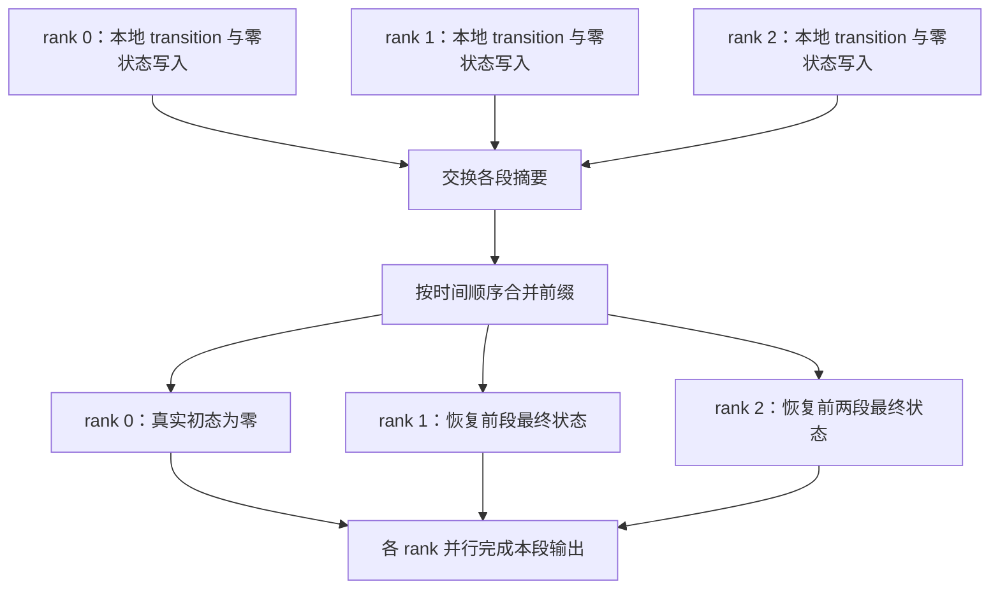

# 06 · Linear attention CP 与 KCP

Dense/sparse softmax 的 CP 围绕远程 KV 展开，linear attention 则把历史压进固定大小的状态。看起来只需把状态从前一张卡传给后一张卡，但这样会把整条序列重新串行化。本篇从状态转移的可组合性出发，推导如何让各 rank 同时处理自己的序列，再恢复正确的边界状态；重点是 KDA Context Parallelism（KCP）的前向、反向与 FLA 实现。

前置内容见 [linear attention 基础](../../attention/mechanisms/06_linear_foundation.md)、[delta rule](../../attention/mechanisms/08_linear_delta_rule.md) 和 [KDA](../../attention/mechanisms/09_linear_kda_kimi.md)。本文采用列向量，状态 $S\in\mathbb R^{d_k\times d_v}$；CP 度记为 $p$，总序列长度记为 $N$。

## 1. 为什么固定状态仍需要 CP

固定状态只说明 decode 时的历史存储不随 $N$ 增长。训练仍要计算所有位置的 projection、gate、FFN，并保存或重算 activation；prefill 也必须处理所有输入 token。长序列下，这些工作与内存仍需要分到多张卡。

最直接的 state passing 是：rank 0 先算完第一段，把最终状态传给 rank 1，然后依次传递。通信确实很小，但关键路径仍经过全部 $N$ 个 token，没有并行训练的收益。要使各 rank 提前计算，就必须找到不依赖真实输入状态的段摘要。

## 2. 从加法前缀和到 affine scan

朴素 linear attention 的递推为

$$
S_t=S_{t-1}+k_tv_t^\top.
$$

rank $r$ 负责连续区间 $[a_r,b_r]$，可以独立计算

$$
B_r=\sum_{t=a_r}^{b_r}k_tv_t^\top.
$$

若初始状态为零，rank $r$ 的输入状态就是 $\sum_{j<r}B_j$。这是 exclusive prefix sum；normalized linear attention 还需对 normalizer $z$ 做相应前缀和。

有衰减时，局部写入会被后续 token 再次衰减。更一般地，令

$$
S_t=A_tS_{t-1}+B_t.
$$

一段 token 的整体作用仍是 affine map：

$$
S_r^{\mathrm{out}}=\mathcal A_rS_r^{\mathrm{in}}+\mathcal B_r,
$$

$$
\mathcal A_r=A_{b_r}A_{b_r-1}\cdots A_{a_r},\qquad
\mathcal B_r=\sum_{t=a_r}^{b_r}
\left(A_{b_r}\cdots A_{t+1}\right)B_t.
$$

空乘积定义为单位矩阵。$\mathcal B_r$ 就是从零状态处理该段得到的输出；$\mathcal A_r$ 则描述这一段如何改变任意外来状态。两者都只依赖本段 token，可以在各 rank 独立计算。

### 摘要怎样组合

先处理段 0，再处理段 1，组合结果为

$$
(\mathcal A_1,\mathcal B_1)\circ(\mathcal A_0,\mathcal B_0)
=\left(\mathcal A_1\mathcal A_0,
\mathcal A_1\mathcal B_0+\mathcal B_1\right).
$$

该操作可结合，但一般不可交换。这是 affine prefix scan 的依据：可以改变括号，不能打乱时间顺序。前向所需的是每个 rank 之前所有段的组合，而非把全组摘要做无序 all-reduce。

一个标量例子即可说明为什么不能只相加：第一段为 $S\mapsto0.5S+2$，第二段为 $S\mapsto0.25S+3$，从零出发结果是 3.5；局部零状态结果相加却是 5。丢掉 transition 就丢掉了后段对前段记忆的修改。

## 3. KDA 为什么需要矩阵 transition

KDA 的单 token 更新为

$$
S_t=\underbrace{\left(I-\beta_tk_tk_t^\top\right)
\operatorname{Diag}(\alpha_t)}_{A_t}S_{t-1}
+\underbrace{\beta_tk_tv_t^\top}_{B_t},
\qquad o_t=S_t^\top q_t.
$$

$\alpha_t$ 是 $d_k$ 维 channel-wise 衰减，$\beta_t$ 控制 delta 写入。顺序是先衰减旧状态，再擦除当前 key 方向上的预测并写入新 value。对角衰减和 rank-one 擦除一般不交换，不能把 $\operatorname{Diag}(\alpha_t)$ 任意移到左侧。

对照几种状态模型：

| 机制 | 单 token transition | 段摘要的结构 |
|---|---|---|
| 朴素 linear | $I$ | 只需加法写入摘要 |
| Retention / 标量 decay | $\alpha_tI$ | 一个衰减乘积 + 写入摘要 |
| GLA | $\operatorname{Diag}(\alpha_t)$ | 通道衰减向量 + 写入摘要 |
| GDN | $\alpha_t(I-\beta_tk_tk_t^\top)$ | 通常形成稠密矩阵 |
| KDA | $(I-\beta_tk_tk_t^\top)\operatorname{Diag}(\alpha_t)$ | 通常形成稠密矩阵 |

多次 rank-one 更新的乘积一般不再保持单个 rank-one 形式。KDA CP 因此需要 $d_k\times d_k$ 的累计 transition，以及 $d_k\times d_v$ 的零状态写入。直接套用朴素 linear attention 的 state sum 会算错，哪怕局部 KDA 算子本身完全正确。[Kimi K3 §5.1.2](https://arxiv.org/abs/2607.24653)以此构造 KCP。

## 4. KCP forward 的三个阶段

**第一阶段：本地准备。** 每个 rank 构造 $(\mathcal A_r,\mathcal B_r)$，还可以提前完成 Q/K/V projection、gate 与块内独立计算。

**第二阶段：跨 rank 恢复边界。** 一种直接实现是 all-gather 摘要，然后各 rank 对前面的段做有序 merge：

$$
S_r^{\mathrm{in}}
=\sum_{j<r}\left(\mathcal A_{r-1}\cdots\mathcal A_{j+1}\right)\mathcal B_j,
$$

其中初始状态为零。理论上也可用树形 exclusive scan 降低跨 rank 的依赖深度，但具体通信模式与矩阵乘法代价要一起衡量。**FLA 参考实现采用 all-gather + merge，不能把理论 scan 描述成它已经使用的网络算法。**

**第三阶段：本地求值。** 拿到真实初态后，用已有 chunkwise KDA 算子计算该 rank 的输出。对于本段任意位置，等价地有

$$
S_t=\widetilde S_t+A_tA_{t-1}\cdots A_{a_r}S_r^{\mathrm{in}}.
$$

这说明零状态工作可以复用，但不意味着应保存每个 token 的完整 transition。实际实现按 chunk 重算、复用中间量或 fused correction，在算力、显存与并行度之间选择。

## 5. Chunkwise 形式怎样生成摘要

逐 token 做稠密 $A_t$ 连乘代价很高。KDA 的 WY/UT 表示先把一个 chunk 内的递推转换成矩阵乘法。令 chunk 长度为 $C$，其辅助矩阵为 $W\in\mathbb R^{C\times d_k}$、$U\in\mathbb R^{C\times d_v}$，$K_g$ 为已经乘上到 chunk 末尾衰减的 key，$D$ 为整个 chunk 的对角衰减，则

$$
S_{\mathrm{next}}=DS+K_g^\top(U-WS)
=\underbrace{(D-K_g^\top W)}_{\mathcal A_{\mathrm{chunk}}}S
+\underbrace{K_g^\top U}_{\mathcal B_{\mathrm{chunk}}}.
$$

这把 chunk 内纠错与 gate 都封装成一个 affine map。rank 内再把多个 chunk map 按顺序合并，即得到 rank 摘要。$W,U$ 的生成来自已有 KDA 算法，不是 CP 额外发明的一套 attention；推导见 [delta rule 的 WY 表示](../../attention/mechanisms/08_linear_delta_rule.md)。

这里要特别区分两个「chunk」：算子 tile 常为几十个 token，CP rank 的 local segment 可有几千到几十万个 token。一个 rank 摘要通常涵盖许多算子 chunk。

## 6. Backward 是反向 affine scan

只把 forward 初态接对还不够。rank $r$ 的状态会影响之后所有 rank 的输出，后面的 loss 必须反传回来。

令 $\Lambda_r^{\mathrm{out}}$ 为后续段损失对当前段输出状态的梯度，$R_r$ 为当前段本地输出损失对输入状态的梯度。由
$S_r^{\mathrm{out}}=\mathcal A_rS_r^{\mathrm{in}}+\mathcal B_r$，有

$$
\Lambda_r^{\mathrm{in}}
=\mathcal A_r^\top\Lambda_r^{\mathrm{out}}+R_r.
$$

所以 backward 也能表示成 affine map，只是沿 rank 的相反方向组合。先求每段自己的梯度摘要，再交换摘要、从后往前恢复边界梯度，最后完成本地 Q/K/V、gate 和 beta 的梯度。

一个常见误读是把实现中的 backward transition `dM` 当成 $\nabla_M\mathcal L$。在 FLA 的这段预处理记号中，它表示用于传播状态梯度的**转置 transition**。真正对模型参数的梯度还必须包含该 transition 与写入对 K、gate、beta 的依赖。例如单 token 的后向状态递推可写为

$$
G_t=\Lambda_t+q_t(\nabla_{o_t}\mathcal L)^\top,
\qquad
\Lambda_{t-1}=A_t^\top G_t.
$$

这里 $\Lambda_t$ 汇总未来位置的贡献；本地 loss 通过第二项进入，随后再沿状态链传递。若跨 rank 边界 detach，forward 看起来仍可正确，训练梯度却已经改变。

## 7. 通信与计算的边界

单个 head、单段摘要需要 $d_k^2+d_kd_v$ 个元素。若有 $H$ 个 state heads、摘要精度为每元素 $b_s$ 字节，则

$$
B_{\mathrm{summary}}=b_sH(d_k^2+d_kd_v).
$$

ring all-gather 中，每个 rank 接收约 $(p-1)B_{\mathrm{summary}}$。固定 $p,H,d_k,d_v$ 时它不随 $N$ 增长，但随 CP 度和 state dimension 增长；packed sequence 的跨边界情况也会影响 metadata 与摘要数量。

例如 $d_k=d_v=128$、64 个 state heads、FP32 摘要，一段摘要约 8 MiB；CP=8 时每 rank 接收约 56 MiB。对比同一示意配置下 128K token 的 BF16 K/V 约 4 GiB，状态通信具有明显优势。不过这只是给定 head shape 的账本，GQA、MLA、Grouped Value Attention 必须分别代入实际维度。

KCP 仍增加本地 transition 构造和 merge 的计算。如果每段太短，准备摘要与 collective 启动成本可能超过节省的序列计算。随着 $p$ 增长，local compute 减少，摘要大小却不减少，因此不能无限强扩展。矩阵 prefix scan 还可能有 $d_k^3$ 级的矩阵组合成本，需利用 chunk 结构或选择合适的 merge 算法。

## 8. Packed sequence 与短卷积

### 文档边界必须 reset

FLA 的 CP 输入是按全局 token 顺序连续切分的 packed stream。每个文档开头都应从零状态开始，不能把上一个文档的状态传过去。文档可能跨多个 rank，也可能有多个短文档完全位于一个 rank 内。

在这种连续布局下，只有本地第一段文档可能继承前一 rank 的状态；只有本地最后一段可能继续传给下一 rank。实现用 global `cu_seqlens` 构建 rank-local metadata，记录 continuation 的前后 rank 数，并只交换真正跨边界的状态。单纯把每个 rank 的全部 token 合成一份无 reset 摘要是不正确的。

### Causal convolution 还需要 halo

KDA 层常在 Q/K/V 前使用短 causal convolution。状态摘要没有包含卷积输入历史；长度为 $w$ 的卷积还需前方 $w-1$ 个输入作为 halo。backward 也要把 halo 的梯度累积回 owner，并在文档边界截断。只实现 KDA recurrent state 通信而漏掉卷积 halo，会在每个 CP 切口产生误差。

## 9. 与 softmax 层共存

Kimi Linear/K3 等 hybrid 模型包含 KDA 和 MLA。KDA 最自然的布局是连续时间段；dense causal softmax 常用 zigzag 配对平衡前后位置的计算量。两种布局的目标不同。

一种实现可以全程保留连续 sequence shard，KDA 做 affine merge，MLA 用支持此布局的 ring 或 head all-to-all；另一种可以在 softmax 层前后做显式 permutation。无论哪种，都要把布局转换成本计入模型级吞吐，而不是只报告 KDA 算子加速。NVIDIA 的 [Kimi Linear CP 文档](https://docs.nvidia.com/nemo/automodel/latest/nemo-automodel/nemo_automodel/components/models/kimi_linear/cp)也将两类层的兼容性作为独立问题。

KDA 的 forward 摘要允许按序 prefix scan，却不允许不带额外处理就按 zigzag 的 rank 编号扫描。若 rank 持有多个不连续区间，每个区间都要保留自己的全局位置与 transition 顺序。

## 10. FLA 实现对照

本仓库的 FLA 引用统一固定到 commit `1b74d1e0`（2026-10-27，v0.6.0），本节与 attention 章节使用同一版本。官方说明明确：这份公开实现由社区贡献，与 Moonshot 内部 KCP 是独立代码库。

| 机制 | 参考实现 |
|---|---|
| 全局/本地 varlen metadata，边界关系 | [[fla:fla/ops/cp/context.py]] |
| 摘要打包、通信与精度策略 | [[fla:fla/ops/cp/comm.py]] |
| forward 的零状态与 transition 预处理 | [[fla:fla/ops/cp/chunk_fwd.py]] |
| backward 的转置 transition 与梯度摘要 | [[fla:fla/ops/cp/chunk_bwd.py]] |
| 按时间顺序 merge 摘要 | [[fla:fla/ops/cp/chunk_merge.py]] |
| 整体约束与 KDA/GDN 区别 | [[fla:fla/ops/cp/README.md]] |

KDA 把 channel-wise gate 预先吸收到 `kg/qg` 中；GDN 的标量 gate 可在通用算子内处理。CP 预处理和主计算必须使用一致的张量与 log 底数，不能在前者用原 K、后者用 gated K。

这一版本要求 varlen CP 输入 batch 维为 1，通过 context 传入 rank-local `cu_seqlens`；CP 模式不接受用户提供 `initial_state`，也不导出 `output_final_state=True`。这些是当前 API 约束，不是 affine scan 的数学限制。

transition chain 的累计精度尤其重要。该版本在 NVIDIA Ampere 及更新架构使用 TF32x3 路径，在 Ascend 使用 IEEE FP32；摘要链不能每步都回写 BF16 后再连乘。K3 的 bounded decay 有助于局部缩放范围，但不等于可以忽略跨 rank 的累积误差。

## 11. 验证与调优

验证应同时比较输出与所有输入梯度，覆盖一条跨多 rank 的长文档、多条 packed 文档、恰好落在 rank 边界的 reset、短卷积和非零 gate。只比较最后状态不足以验证所有 query 输出；只比较 forward 也发现不了边界 detach。

性能上，分别观察本地 WY/摘要构造、通信、merge、主 attention 的时间，再比较完整 hybrid block。增加 CP 度前先确认本地序列仍足够长；需要更高并行度时，可联合 head/sequence 分片，并与 FFN、EP 的布局转换一起衡量。

参考：[Kimi K3 §5.1.2](https://arxiv.org/abs/2607.24653)、[Kimi Linear](https://arxiv.org/abs/2510.26692)、[[fla:fla/ops/cp/README.md|FLA CP 设计说明]]。上一节的 [sparse CP](./05_sparse_attention_cp.md)以 KV 访问图为核心，本节则以有序 affine 状态传播为核心；两类通信不能互相替代。
